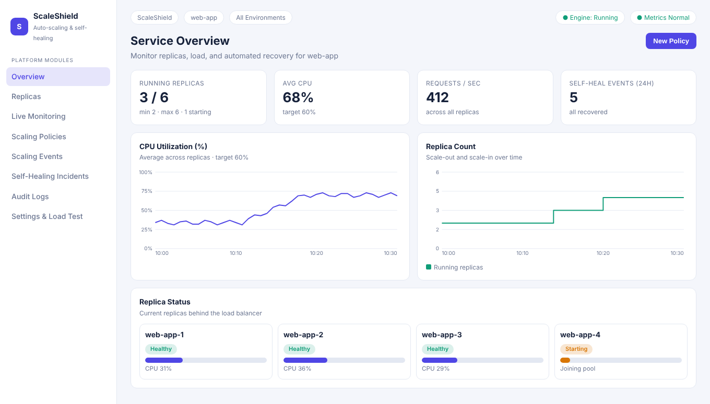
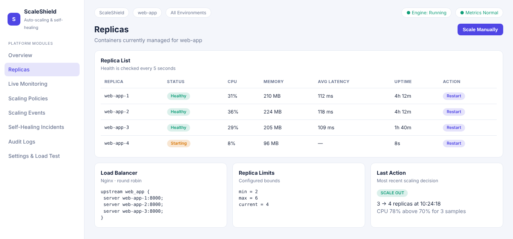
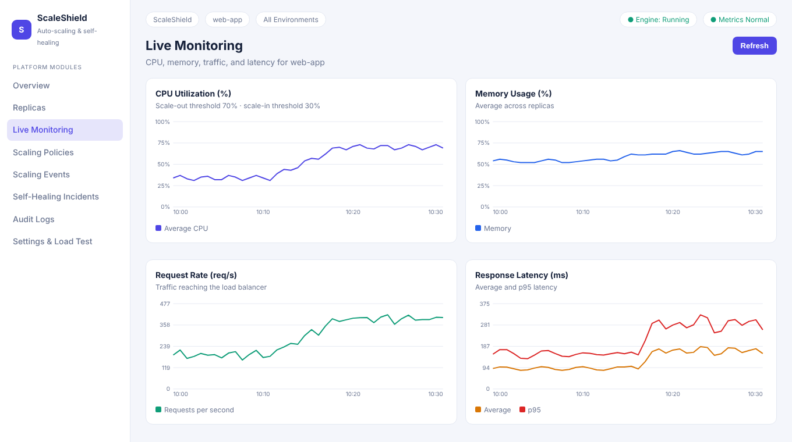
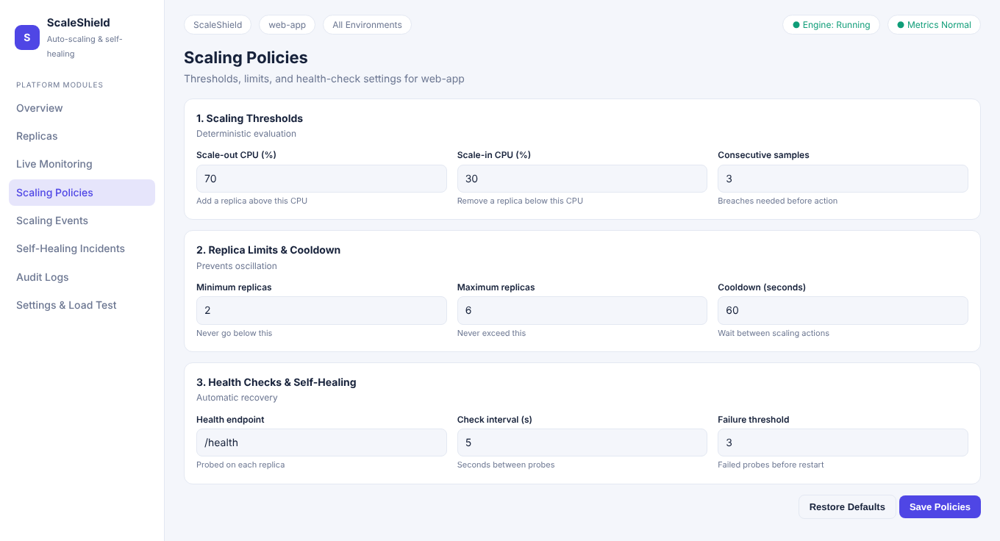
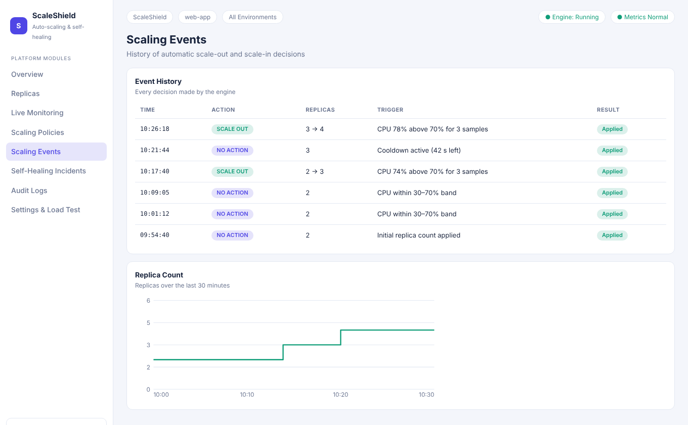
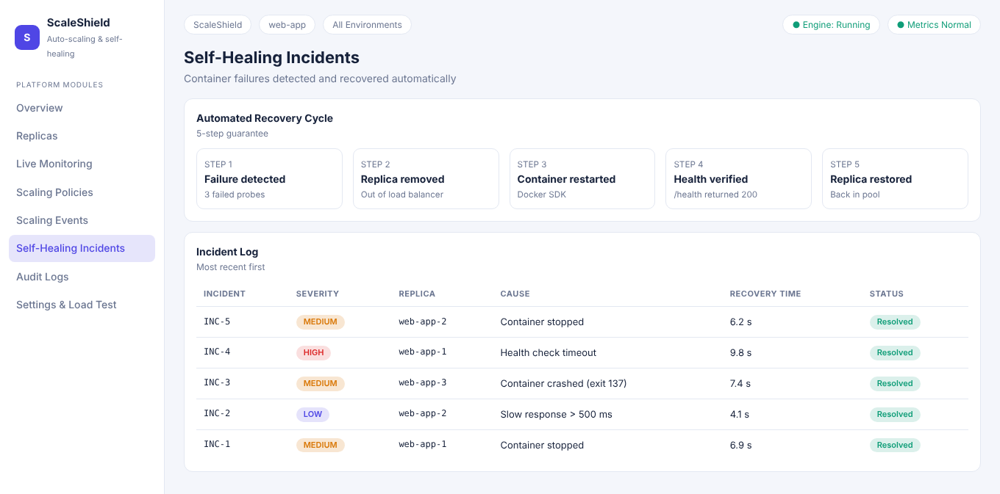
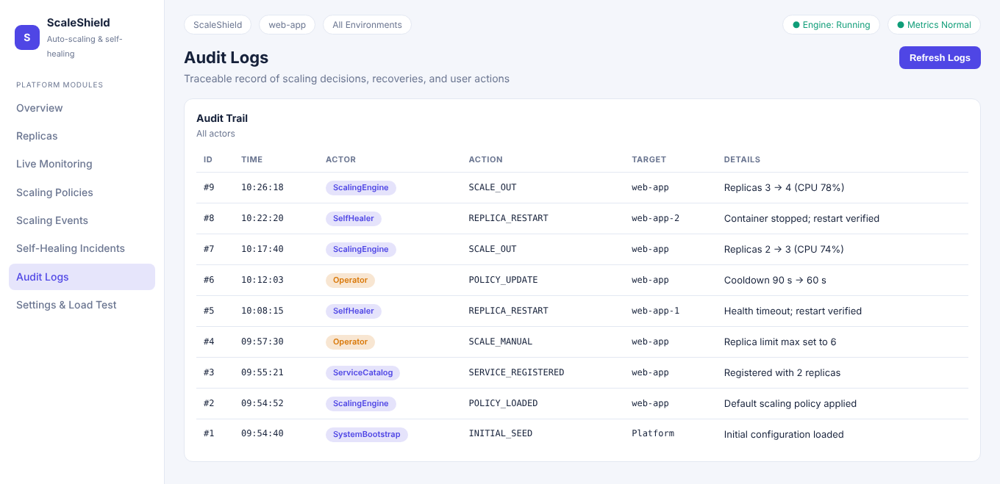
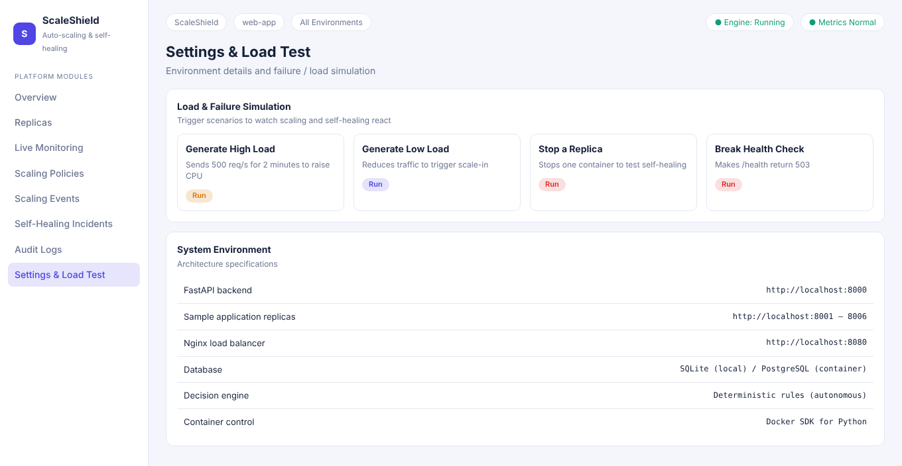
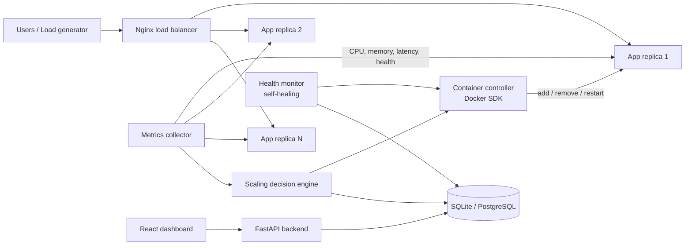

# ScaleShield

**Metrics-Driven Auto-Scaling & Self-Healing Platform**

One-week DevOps technical project.

## About the project

Applications that run a fixed number of instances cannot follow changing demand. They slow down under heavy load, waste resources when traffic is low, and stay broken until someone notices a crashed container.

ScaleShield addresses this with two DevOps practices:

- **Auto-scaling:** add or remove application replicas based on CPU utilization and request load, within a configured minimum and maximum.
- **Self-healing:** probe every replica's health endpoint, restart replicas that fail, and confirm they recover before they receive traffic again.

Decisions come from a deterministic rule engine. A scaling action happens only after a threshold is breached for several consecutive samples and the cooldown period has passed, which prevents replicas from flapping up and down on short spikes.

## What is in this repository

This repository contains the **web dashboard demo** and its screenshots.

| Path | Description |
|---|---|
| `index.html` | ScaleShield dashboard. Single file, no build step. Runs on sample data. |
| `docs/screenshots/` | Screenshots of every dashboard page. |

The dashboard is a front-end demonstration. Its charts and tables use fixed sample data, and the buttons do not control real containers. The full platform design (FastAPI backend, Docker SDK, Nginx, PostgreSQL) is not implemented in this repository.

## Dashboard pages

| Page | Shows |
|---|---|
| Overview | Replica count, average CPU, request rate, replica status |
| Replicas | Replica list with health, CPU, memory, latency, uptime; load balancer pool |
| Live Monitoring | CPU, memory, request rate, average and p95 latency charts |
| Scaling Policies | Scale-out and scale-in thresholds, replica limits, cooldown, health-check settings |
| Scaling Events | History of scale-out, scale-in, and no-action decisions |
| Self-Healing Incidents | Recovery cycle and log of detected failures |
| Audit Logs | Traceable record of system and operator actions |
| Settings & Load Test | Load and failure simulation controls, system environment |

## Screenshots

| | |
|---|---|
|  |  |
|  |  |
|  |  |
|  |  |

## Run locally

No installation is needed. Either open `index.html` in a browser, or serve the folder:

```bash
git clone https://github.com/asish358/devops_project.git
cd devops_project
python3 -m http.server 8000
```

Then open <http://localhost:8000>. Pages are reached through the sidebar (for example `#replicas`, `#monitoring`).

## Deploy with GitHub Pages

1. Open the repository on GitHub, then **Settings**, then **Pages**.
2. Under **Build and deployment**, set **Source** to **Deploy from a branch**.
3. Choose branch **main** and folder **/ (root)**, then **Save**.
4. After a minute the site is live at `https://asish358.github.io/devops_project/`.

## Proposed architecture



## Scaling rules used in the demo

| Setting | Value |
|---|---|
| Scale-out threshold | CPU above 70% |
| Scale-in threshold | CPU below 30% |
| Consecutive samples required | 3 |
| Minimum / maximum replicas | 2 / 6 |
| Cooldown | 60 seconds |
| Health-check interval | 5 seconds |
| Failed probes before restart | 3 |

## Technologies

- **Dashboard (this repository):** HTML, CSS, and JavaScript with inline SVG charts.
- **Full platform (proposed design):** Python, FastAPI, SQLAlchemy, React, TypeScript, Docker, Docker Compose, Nginx, PostgreSQL, Pytest, Vitest, GitHub Actions.

## Limitations

- The dashboard uses sample data and does not control real containers.
- No authentication or role-based access control.
- Single Docker host only in the proposed design; no Kubernetes support.
- External alerting (Slack, PagerDuty) is not included.

## Future scope

- Real FastAPI backend and Docker SDK container control
- Authentication and role-based access control
- Kubernetes and multi-node support
- Persistent policies and real infrastructure metrics
- Slack and PagerDuty alerts
- Predictive scaling from historical metrics
